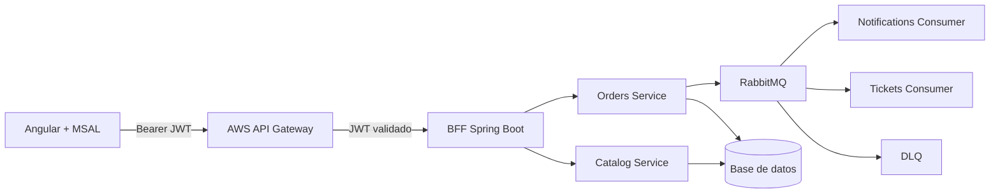

# Pedidos360 - Backend

Backend cloud native construido como proyecto Maven multimódulo con cuatro componentes independientes:

- `bff-service` (8080): único punto público. Valida JWT de Microsoft Entra ID y aplica autorización.
- `orders-service` (8081): microservicio de pedidos con entidad y repositorio JPA.
- `catalog-service` (8082): microservicio de catálogo con entidad y repositorio JPA.
- `rabbit-admin-service` (8083): API interna para administrar colas, exchanges y bindings de RabbitMQ.

## Arquitectura



El token se valida dos veces: API Gateway funciona como perímetro y el BFF aplica defensa en profundidad. Spring Security verifica firma criptográfica, `iss`, `aud`, `exp` y `nbf`. Los claims `scp` se convierten en autoridades `SCOPE_...` y `roles` en autoridades `ROLE_...`.

## Requisitos

- Java 17
- Maven 3.9+
- Docker y Docker Compose (alternativa recomendada)

## Configuración

Copiar `.env.example` como `.env` y reemplazar:

| Variable | Ejemplo | Propósito |
|---|---|---|
| `AZURE_ISSUER_URI` | `https://login.microsoftonline.com/<tenant>/v2.0` | Emisor exacto permitido |
| `AZURE_API_AUDIENCE` | `<api-client-id>` | Audiencia exacta esperada en tokens v2 |
| `FRONTEND_ORIGIN` | `http://localhost:4200` | Origen CORS permitido |

Para conectar una base cloud (por ejemplo, Amazon RDS PostgreSQL), definir en cada microservicio `DB_URL`, `DB_USER`, `DB_PASSWORD` y `DDL_AUTO=validate`. Sin estas variables se utiliza H2 en memoria para desarrollo.

## Ejecución

```bash
mvn clean test
mvn -pl orders-service spring-boot:run
mvn -pl catalog-service spring-boot:run
mvn -pl bff-service spring-boot:run
mvn -pl rabbit-admin-service spring-boot:run
```

O ejecutar los tres componentes:

```bash
docker compose up --build
```

RabbitMQ queda disponible en:

| Servicio | URL / puerto | Credenciales |
|---|---|---|
| AMQP | `localhost:5672` | `guest` / `guest` |
| Management UI | `http://localhost:15672` | `guest` / `guest` |

## Mensajería RabbitMQ

Los nombres de colas, exchanges y routing keys están centralizados en `orders-service/src/main/resources/application.yml`, bajo `pedidos360.rabbitmq`.

| Recurso | Nombre |
|---|---|
| Exchange principal | `pedidos360.orders.exchange` |
| Exchange DLX | `pedidos360.orders.dlx` |
| Cola de notificaciones | `pedidos360.notifications.queue` |
| Cola de tickets | `pedidos360.tickets.queue` |
| Cola DLQ | `pedidos360.orders.dlq` |

Flujo implementado:

1. El frontend crea un pedido demo mediante el BFF.
2. El BFF llama a `orders-service`.
3. `orders-service` guarda el pedido y publica dos eventos asincronos: notificacion y ticket.
4. Los consumidores procesan mensajes con `@RabbitListener` y ACK manual.
5. Si el mensaje es invalido o falla luego del reintento, se rechaza con `requeue=false` y RabbitMQ lo mueve a la DLQ.
6. El consumidor de DLQ registra el mensaje fallido en logs.

## API administradora de RabbitMQ

Endpoints internos de `rabbit-admin-service`:

| Metodo | Ruta | Uso |
|---|---|---|
| `POST` | `/internal/rabbit/queues` | Crear cola |
| `DELETE` | `/internal/rabbit/queues/{name}` | Eliminar cola |
| `POST` | `/internal/rabbit/exchanges` | Crear exchange |
| `DELETE` | `/internal/rabbit/exchanges/{name}` | Eliminar exchange |
| `POST` | `/internal/rabbit/bindings` | Crear binding |
| `DELETE` | `/internal/rabbit/bindings` | Eliminar binding |

Ejemplo para crear una cola con DLQ:

```bash
curl -X POST http://localhost:8083/internal/rabbit/queues \
  -H "Content-Type: application/json" \
  -d '{"name":"demo.queue","durable":true,"deadLetterExchange":"pedidos360.orders.dlx","deadLetterRoutingKey":"orders.dead","messageTtl":30000}'
```

## Endpoints y autorización

| Endpoint público del BFF | Regla |
|---|---|
| `GET /actuator/health` | Público |
| `GET /api/orders` | Scope `Pedidos.ReadWrite` o rol `Pedidos.Admin`/`Pedidos.Operador` |
| `GET /api/catalog` | Scope `Pedidos.ReadWrite` |

Un token ausente, mal firmado, vencido, de otro issuer o con audiencia incorrecta genera `401`. Un token válido sin scope/rol suficiente genera `403`.

## AWS

1. Desplegar los JAR o contenedores en EC2 dentro de una VPC.
2. Exponer públicamente solo el BFF; los microservicios deben permanecer en red privada.
3. Importar `deploy/api-gateway-openapi.yml` como definición de una HTTP API.
4. Reemplazar tenant, client ID, región, API ID y DNS de EC2.
5. Restringir el Security Group del BFF para aceptar tráfico desde la infraestructura definida.

Nunca se deben versionar secretos ni tokens. `.env` está excluido mediante `.gitignore`.

## Evidencia de pruebas

`AudienceValidatorTest` demuestra aceptación de la audiencia correcta y rechazo de una incorrecta. Antes de entregar, ejecutar `mvn clean test` y adjuntar una captura del resultado exitoso.
